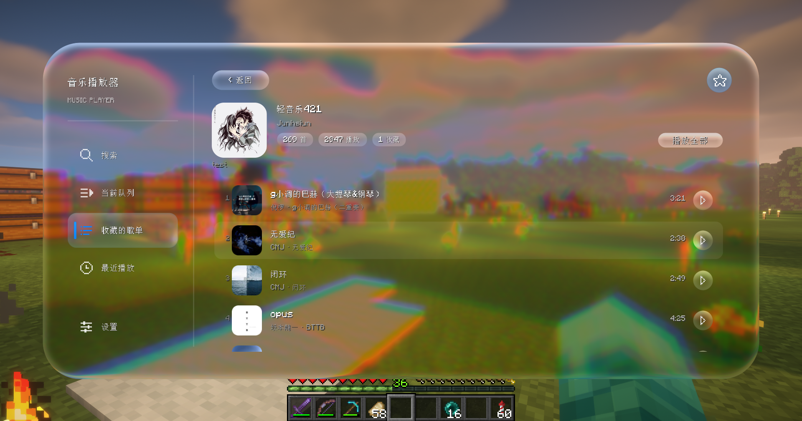
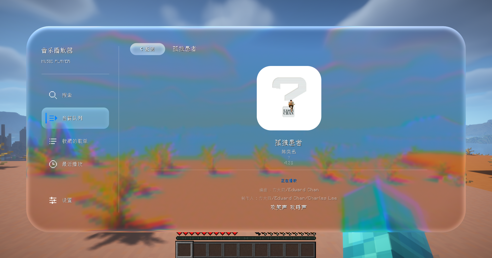
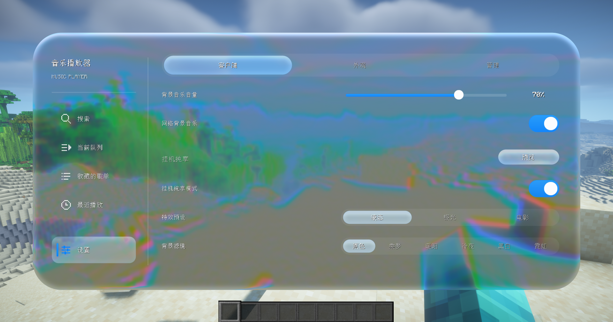
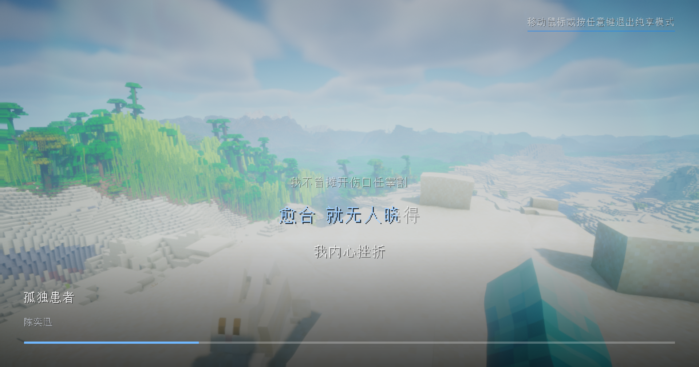
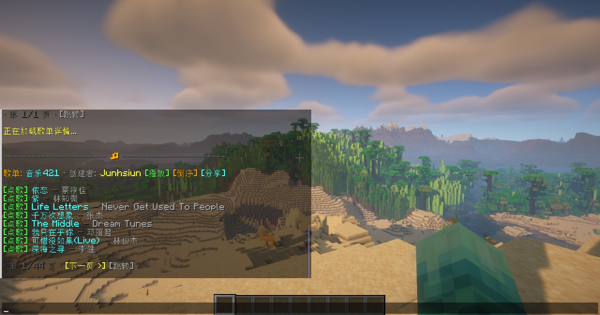
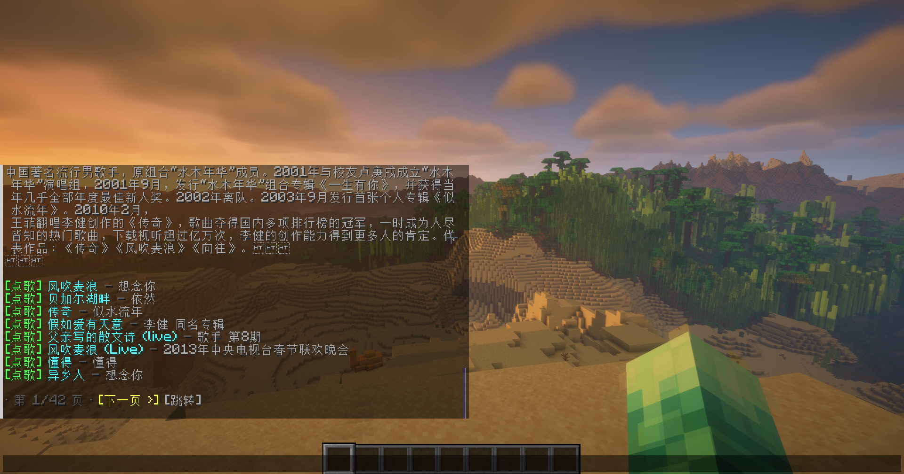
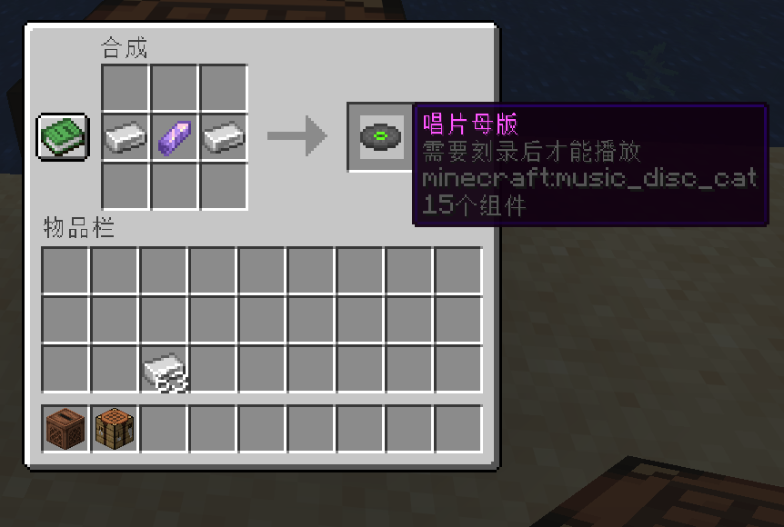
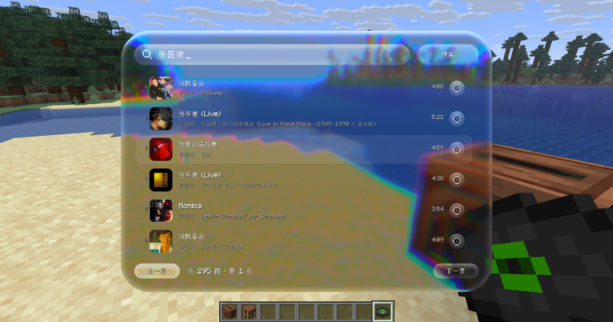
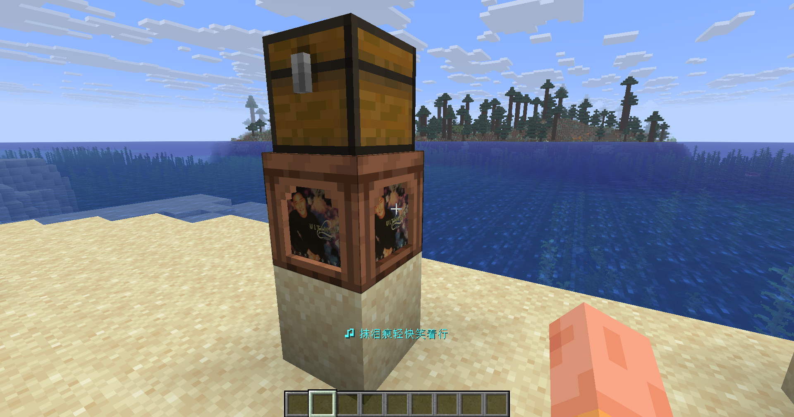

# Minecraft Music Player

[](README.md) [](README_EN.md)

Minecraft Music Player 是一个 Fabric 双端音乐模组：在游戏内浏览、点播网易云音乐，支持歌单与播客、实时歌词、网络背景音乐、可刻录的音乐唱片和唱片机播放。

服务端负责命令、队列、配置与同步，客户端负责音频播放与界面。服务端和需要听歌的客户端都需要安装本模组。

[演示视频](https://www.youtube.com/watch?v=4kOa9Ak62Bk)

## 截图



















## 功能

- 液态玻璃界面：音乐浏览器、设置、唱片刻录共用一套视觉与动画。
- 音乐浏览：搜索音乐、歌单、歌手、用户、播客，支持收藏歌单与最近播放。
- 点播与队列：单曲点播、单点队列优先、歌单自动补充、投票切歌。
- 歌单与播客：后台分批加载，支持正序、倒序、随机。
- 实时歌词：全局播放与唱片机均支持，按玩家独立开关。
- 网络背景音乐：接管原版背景音乐，可独立开关与调节音量。
- 挂机纯享：长时间无操作时隐藏 HUD，叠加可配置的视觉特效与歌词。
- 音乐唱片：将歌曲刻录到唱片，放入唱片机播放，封面与音量随距离变化。
- 内容分享：把歌单、歌手、用户、播客或链接分享给其他玩家。
- 内置简体中文、英文、日文。

### 音乐浏览器

默认快捷键 `M` 打开，可在 `选项 → 控制` 中修改。

- 左侧导航：搜索、当前队列、收藏的歌单、最近播放、设置。
- 搜索框输入关键词，或直接粘贴 `music.163.com` 的单曲、歌单、播客链接。
- 搜索页可在音乐、歌单、歌手、用户、播客之间切换标签页。
- 列表行支持播放与加入队列；歌单详情页可收藏，歌曲详情页显示歌词。

### 挂机纯享

在设置「客户端」页开启。连续 60 秒没有键鼠输入且正在播放音乐时自动进入，隐藏 HUD 并显示特效与歌词；移动鼠标或按任意键退出。可配置特效预设、背景滤镜、触发时间、特效强度与歌词字号，并支持预览。

### 音乐唱片

- 使用铁锭与紫水晶碎片合成**唱片母版**。
- 手持母版右键空气打开刻录界面，搜索歌曲并刻录。
- 刻好的唱片放入唱片机播放，唱片机会显示封面，音量随距离衰减。
- 战利品箱有概率生成随机音乐唱片，概率与数量可配置。

### 网络背景音乐

- 服务端通过 `bgmPlaylistId` 指定歌单，玩家进入游戏后自动播放。
- 客户端在 `选项 → 声音` 中可开关网络背景音乐并调整音量。
- 接口不可用时自动回退原版背景音乐。

### 内容分享

`/music share <玩家> <歌单|歌手|用户|播客|节目|链接>` 会把内容以可点击消息发送给对方，对方点击即可在音乐浏览器中查看。

## 命令

玩家命令：

| 用途 | 命令 |
| --- | --- |
| 播放控制 | `/music now`、`/music seek <秒>`、`/music skip`、`/music mute once` |
| 点播 | `/music play song <歌曲ID>`、`/music play playlist <歌单ID> [reverse]`、`/music play program <节目ID>`、`/music play radio <播客ID> [reverse]` |
| 队列 | `/music queue [页码]`、`/music queue promote <歌曲ID>`、`/music queue remove <歌曲ID>` |
| 播放模式 | `/music playlist`、`/music playlist list`、`/music playlist stop`、`/music playlist order [sequential\|reverse\|shuffle]` |
| 搜索 | `/music search <song\|artist\|playlist\|user\|radio> <关键词> [page <页码>]` |
| 查看 | `/music view <playlist\|artist\|user\|radio\|program> <ID> [page <页码>]`、`/music view <链接>` |
| 分享 | `/music share <玩家> <与 view 一致的参数>` |
| 唱片 | `/music burn song <歌曲ID>` |
| 其他 | `/music random [refresh]`、`/music join`、`/music leave`、`/music lyrics [on\|off\|status]`、`/music help` |

管理员命令：

| 用途 | 命令 |
| --- | --- |
| 播放管理 | `/music pause`、`/music resume`、`/music skip`、`/music queue clear` |
| 配置管理 | `/music config reload`、`/music config status`、`/music config clearqueue`、`/music config set <键> <值>`、`/music config reset <键\|bgmPlaylist\|all>` |

## 配置

配置集中在 `config/minecraft-music-player.json`，分为服务端共用字段与 `client`、`glass`、`idle` 分节。常用键：

| 键 | 默认值 | 说明 |
| --- | --- | --- |
| `neteaseBaseUrl` | `https://mycelis.dpdns.org/` | 后端 API 地址 |
| `apiMode` | `auto` | `auto` 直连优先、`direct` 仅直连、`proxy` 仅后端 |
| `bgmPlaylistId` | `18481322122` | 网络背景音乐歌单，空值关闭 |
| `proxy` / `useSystemProxy` | 空 / `true` | 手动代理与系统代理 |
| `preferIpv4` | `true` | 优先使用 IPv4 |
| `allowSongRequest` / `allowPlaylistRequest` | `true` | 允许玩家点播单曲 / 歌单与播客 |
| `autoAdvance` | `true` | 播放结束后自动切歌 |
| `searchLimit` | `8` | 每页显示数量 |
| `maxQueueSize` / `maxSongsPerPlayer` | `40` / `5` | 队列上限与每位玩家点播上限 |
| `voteSkipPercent` | `0.6` | 投票跳过所需比例 |
| `enableLootMusicDiscs` | `true` | 战利品箱随机唱片开关 |

界面或命令修改后会立即生效并写回文件。完整参数说明见 [配置文档](docs/configuration.md)。

## 文档

- [配置系统](docs/configuration.md)
- [界面与液态玻璃](docs/glass-window.md)
- [音乐浏览器](docs/music-browser.md)
- [版本适配](docs/version-porting.md)

## 构建

需要 Java 25：

```powershell
.\gradlew.bat clean build
```

产物位于 `build/libs`。本地发布构建可使用 `release.bat`。

## 许可证

MIT
